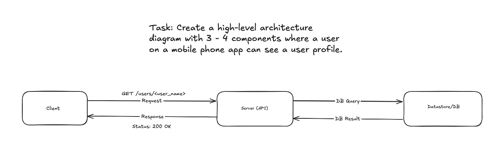

# System Design Lesson 1: The Fundamentals

## Topics Covered

- HTTP methods
- HTTP status codes
- The request and response cycle
- High-level architecture

## Key Terms

### General Concepts

- **High-level diagram:** A diagram showing the main components of a system and how they interact, without detailed implementation information.
- **Client:** An application, such as a mobile app or web browser, that sends requests to a server.
- **API:** An interface that allows applications to communicate through defined requests and responses.
- **Endpoint:** An API address used to interact with a particular resource, such as `/users/<user_id>`.

### HTTP Methods

HTTP methods describe the action a client wants to perform on a resource. The server handles the request and interacts with the database when needed.

| Method | Purpose | Example |
|--------|---------|---------|
| `GET` | Retrieve a resource. | `GET /users/<user_id>` retrieves a user's profile. |
| `POST` | Submit data, commonly to create a new resource. | `POST /users` creates a user. |
| `PUT` | Replace a resource completely, or create it at the specified address if supported. | `PUT /users/<user_id>` replaces a user's profile. |
| `PATCH` | Update specific parts of a resource. | `PATCH /users/<user_id>` updates a user's display name. |
| `DELETE` | Delete a resource. | `DELETE /users/<user_id>` deletes a user. |

### HTTP Status Codes

Status codes describe the outcome of a request.

| Status Code | Meaning |
|-------------|---------|
| `200 OK` | The request succeeded. For a profile retrieval request, the response contains the requested profile data. |
| `201 Created` | The request succeeded and created a new resource. |
| `400 Bad Request` | The server cannot process the request because of a client error, such as malformed request data. |
| `401 Unauthorized` | The request lacks valid authentication credentials. |
| `403 Forbidden` | The server understands the request but refuses to allow it, commonly because the client lacks permission. |
| `404 Not Found` | The server cannot find the requested resource. |
| `500 Internal Server Error` | The server encountered an unexpected problem that prevented it from completing the request. |

## Scenario

Imagine you are using a mobile app and tap on a user to view their profile. What happens behind the scenes between tapping the profile and seeing the user's information on your screen?

### Solution

The server exposes an API that the mobile app uses to request user information. When you tap on a profile, the app acts as the client and sends a `GET /users/<user_id>` request to the server. The server processes the request and queries the database for the matching user. If the user is found, the server returns their profile data with a `200 OK` status code, and the app displays the information on your screen.

If the user does not exist, the server may return `404 Not Found`, and the app can display an appropriate message. Creating a user is a separate action, typically performed during registration: the client sends a `POST /users` request containing the new user's details. If the server successfully creates the user and saves their information to the database, it returns `201 Created`.

### High-Level Architecture Diagram

